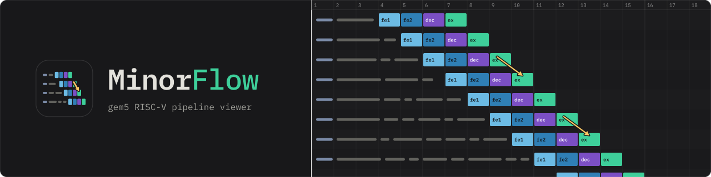
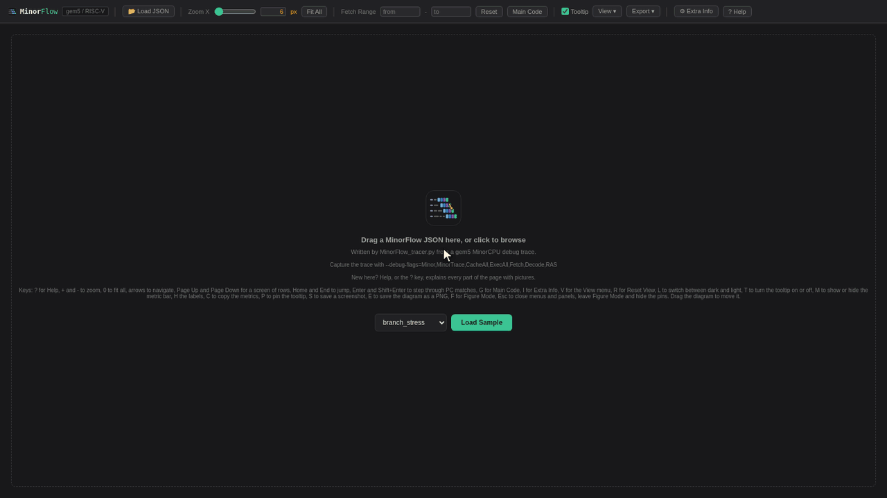

# 

A browser-based pipeline visualiser for gem5's MinorCPU. It reconstructs the pipeline cycle by cycle from a gem5 debug trace and draws every instruction that reached Execute as a row, so you can see exactly where cycles are being lost.



**Try it** at [famaf-cva6-project.github.io/MinorFlow](https://famaf-cva6-project.github.io/MinorFlow/), the page as the `main` branch has it, with its samples a click away and nothing to install.

## Motivation

gem5 tells you an instruction took a long time. It does not tell you why. The debug trace holds the answer, but a real workload produces hundreds of megabytes of it, and reading that by hand is not viable.

MinorFlow turns that trace into a picture. Each row is an instruction, each cell is a cycle in a stage, and the colour tells you what the core was doing: waiting on an I-cache fill, stalled behind a functional unit, held by the scoreboard waiting for an operand, or paying for a mispredicted branch.

## Quick start

Capture a trace from gem5:

```bash
gem5.opt --debug-flags=Minor,MinorTrace,CacheAll,ExecAll,Fetch,Decode,RAS \
         --debug-file=trace.txt \
         configs/gem5_config_MinorFlow.py <binary>
```

Or let [`scripts/run_gem5.py`](#running-a-test-scriptsrun_gem5py) compile the test, run it with those flags and report the metrics, all in one command. Run it **from your gem5 root**, giving the path to this repository's copy of the script:

```bash
cd /path/to/gem5
python3 /path/to/MinorFlow/scripts/run_gem5.py configs/gem5_config_MinorFlow.py daxpy.S
```

The current directory has to be the gem5 root, because that is where the script reads `build/`, `include/` and `util/m5/src/abi/riscv/m5op.S`.

Convert the trace to JSON. The driver leaves a copy in `results/run/` under the gem5 root, so from there:

```bash
python3 /path/to/MinorFlow/MinorFlow_tracer.py results/run/daxpy_trace.txt -o daxpy.json
```

Then open `MinorFlow.html` in any browser and drag `daxpy.json` onto the window, or click **Load JSON**, choose its folder once and pick it from the list. There is nothing to install and nothing to serve. The viewer is a single self-contained HTML file with no dependencies, and **? Help**, or the `?` key, explains every part of it with pictures.

`RAS` is in that flag list because the return-address-stack markers come from it, and it is off by default in gem5. Without it the JSON is still written, but the RAS push, pop and drop markers are absent and `metadata.degraded` lists `ras`, so `--strict` exits 3. The tracer's closing degraded report says so.

### The sample JSONs

The landing page offers the sample JSONs in `tests/`, and this repository commits one per program in `benchmarks/`, so the button works in a fresh clone. A program whose JSON stays under 50 MB has the whole run. A longer one has the records from the start of Main Code, as many as fit under 50 MB, so its sample shows the program's own work rather than its start-up: `branch_stress`, `icache_hit_loop` and `stream_store`, about 65,000 records each, cut with `--from` at Main Code's first record and `-i` at what fits. `scripts/make_MinorFlow_sample.py` trims a full tracer JSON down to one, writing `tests/<source name>.sample.js`, which the page loads, and `tests/<source name>.sample.json` beside it. A sample holds at most the page's `MAX_STREAM_INSTRUCTIONS` records, a limit the script reads from the page. It also keeps `samples.js` beside the sample, a manifest of every sample it wrote there, and warns when that is not the one in `tests/`, since the page loads only `tests/samples.js`. A sample is listed under its output's name without `.sample`, so `tests/daxpy.sample.js` is offered as `daxpy` and named `daxpy (sample)` once loaded.

```bash
python3 scripts/make_MinorFlow_sample.py tests/daxpy.json               # -> tests/daxpy.sample.{json,js}, listed in tests/samples.js
python3 scripts/make_MinorFlow_sample.py tests/daxpy.json -i 1500       # fewer instructions
python3 scripts/make_MinorFlow_sample.py tests/daxpy.json --from 4000   # start past the set-up
```

## Tracer options

```bash
python3 MinorFlow_tracer.py <trace> [-o PATH] [--quiet] [--tpc TICKS] [--strict] [--config-name NAME] [--ras-size N]
```

| Option                       | Meaning                                                                                                                                                                                                                                                                                                                                                                                                                   |
| ---------------------------- | ------------------------------------------------------------------------------------------------------------------------------------------------------------------------------------------------------------------------------------------------------------------------------------------------------------------------------------------------------------------------------------------------------------------------- |
| `trace`                      | The gem5 MinorCPU debug trace (`.txt`, `.log` or `.trace`)                                                                                                                                                                                                                                                                                                                                                                |
| `-o`, `--out`                | Where to write the JSON. Defaults to the trace path with its `.txt`, `.log` or `.trace` extension replaced by `.json` and `_trace` dropped from the file name, so `daxpy_trace.txt` writes `daxpy.json`                                                                                                                                                                                                                   |
| `--quiet`                    | Leave out the progress line                                                                                                                                                                                                                                                                                                                                                                                               |
| `--tpc`, `--ticks-per-cycle` | Ticks per CPU cycle, in place of the detected period, for a trace detection refuses. The start of the trace is still checked, and a period its ticks show to be a multiple or a fraction of the real one is refused. At gem5's default tick rate, 10000 for the 100 MHz Reference Core and 20000 for a 50 MHz core                                                                                                        |
| `--strict`                   | Exit with 3 when `metadata.degraded` is not empty. The JSON is still written. Use it in batch runs so a degraded trace is not mistaken for a complete one. A trace is degraded when a debug-flag line family is missing from the capture, when it was cut part way through a line or leaves an instruction neither committed nor flushed, which a whole run never does, or when it holds no instruction or no commit      |
| `--config-name`              | The gem5 configuration the trace was captured on, written to `metadata.config_name` and shown in Extra Info's Simulation section and the badge's tooltip. A trace does not name it, so this is a label, not a measurement. Defaults to the `Config:` line of the `_report.txt` that `scripts/run_gem5.py` leaves beside the trace, so `daxpy_trace.config1.txt` reads `daxpy_report.config1.txt`, and to null without one |
| `--ras-size`                 | The return address stack's capacity, written to `config_params.ras_size`, which Extra Info sets the stack's depth against. gem5 does not print it, so it is left out unless given                                                                                                                                                                                                                                         |

The tracer reads the trace twice: pass 1 works out the clock period, pass 2 builds the records. Pass 1 reads only the first 20,000 distinct ticks and takes the commonest gap between them, refusing a period those ticks show to be a multiple of the real one. `--tpc` gives the period instead, for a trace detection refuses, and pass 1 then only checks it. Informational, warning, error and degraded lines go to stderr, and the closing summary to stdout.

`scripts/create_all_MinorFlow_jsons.py` converts every trace in a folder, not recursively, the tracer's folder by default, skipping every trace whose JSON is up to date, at least as new as the trace and the tracer and written at the tracer's schema, unless `--force` is given. It converts four at a time by default, each tracer with `--quiet` so their progress lines do not interleave, and prints one line as each trace starts and one as it ends. `-j 1` lets the tracer's progress line through. It passes `--strict` to the tracer by default, so a degraded trace makes the batch exit 3 while every JSON is still written, and `--no-strict` turns that off. A conversion that fails outright makes the batch exit 1 instead. `--dry-run`, or `-n`, prints which traces would be converted to which JSONs and converts nothing. A trace is a `.txt` whose name holds `_trace.`, and each JSON is named after its trace with `_trace` removed, so `daxpy_trace.config1.txt` becomes `daxpy.config1.json`, and takes its `config_name` from the report beside the trace.

## Running a test: `scripts/run_gem5.py`

Capturing a trace by hand means compiling the test against gem5's `m5op.S`, remembering the full debug-flag list, and then reading the numbers out of `stats.txt`. `scripts/run_gem5.py` does all of it in one command.

Run it **from the gem5 root**: the script takes the current directory as the gem5 root and looks there for the build `--variant` names (`build/RISCV` or `build/RISCV_PATCH`) and its `gem5.opt`, `gem5.fast` or `gem5.debug`, and for `./include` and `./util/m5/src/abi/riscv/m5op.S`. The script itself can live anywhere, and so can the config and the test: both are looked for relative to the gem5 root first and then relative to this repository, so a path that is right in the clone works from the gem5 root too. A bare name, with no folder, is looked for in `gem5_configs/config/`, `gem5_configs/viewer/`, `configs/`, `benchmarks/config/`, `benchmarks/viewer/`, `benchmarks/` and `gem5_configs/CARLA2026/`, in that order, under the gem5 root and then this repository. The first match is run, so `benchmarks/config/` comes before `benchmarks/viewer/`, and when several folders hold the name a warning names every copy and the one taken. A path with a folder is taken as given: when it is wrong the run stops and names any file of that name in those folders.

```bash
python3 /path/to/MinorFlow/scripts/run_gem5.py <config>.py <test> [--variant stock|patch] [--build NAME] [--suite config|viewer] [--lang auto|c|asm] [--no-trace] [--gem5-out-dir DIR] [--results-dir DIR] [--skip-build-check]
```

| Argument             | Meaning                                                                                                                                                                             |
| -------------------- | ----------------------------------------------------------------------------------------------------------------------------------------------------------------------------------- |
| `<config>.py`        | The gem5 MinorCPU configuration script, for example [configs/gem5_config_MinorFlow.py](configs/gem5_config_MinorFlow.py)                                                            |
| `<test>`             | The test to run: C (`.c`) or assembly (`.S`, `.s`, `.asm`, `.sx`). The type is detected from the extension                                                                          |
| `--lang`             | Force the input type, which selects both the compile flags and the overhead profile. Defaults to `auto`, detection by extension                                                     |
| `--variant`          | `stock` or `patch`: which build to run and whose overhead profile to subtract. Defaults to `stock`                                                                                  |
| `--build`            | Which build to run: a directory name under `build/`, a path to one, or a path to the binary. Defaults to the build `--variant` names, `RISCV` for stock and `RISCV_PATCH` for patch |
| `--skip-build-check` | Run even when the build does not match `--variant`. Without it a mismatch stops the run, since each variant has its own overhead profile                                            |
| `--suite`            | Which overhead table to subtract, `config` or `viewer`. Defaults to the `.overhead_suite` file beside the test or up to two folders above it, and the run stops without one         |
| `--no-trace`         | Do not write the trace, and report metrics only. Use it when you only want the numbers, since the trace is the expensive part                                                       |
| `--gem5-out-dir`     | Where gem5 writes and the test is compiled. Defaults to `results/m5out/`                                                                                                            |
| `--results-dir`      | Where the files worth keeping are copied. Defaults to `results/run/` under the gem5 root                                                                                            |
| anything else        | Passed on to the configuration script. A configuration that defines its own options gets them this way                                                                              |

What it does, in order:

1. **Compiles.** `riscv64-unknown-elf-gcc` for `rv64gc` with the bit-manipulation and crypto extensions, freestanding (`-nostdlib -nostartfiles -static -mcmodel=medany`), linking gem5's `m5op.S` so the program can call `m5_reset_stats`, `m5_dump_stats` and `m5_exit`. Both languages get `-e main`, since there is no crt0 and so no `_start` to enter through, and C tests also get `-fno-builtin`.
2. **Runs gem5** into `results/m5out/`, adding the debug flags MinorFlow needs (`Minor`, `MinorTrace`, `CacheAll`, `ExecAll`, `Fetch`, `Decode`, `RAS`) and writing `results/m5out/<test>_trace.txt`. That file is the tracer's input.
3. **Disassembles.** `objdump -d -S -l` into `results/m5out/<test>.list`, then writes the listing up to the `jal` to `m5_dump_stats`, which is where the measured region ends, into `results/m5out/<test>_report.txt`, under a `DISASSEMBLED CODE` banner and closed by an `END OF DISASSEMBLED CODE` one.
4. **Prints the table**, parsed from the first statistics block in `stats.txt`, the one delimited by the `m5_reset_stats` and `m5_dump_stats` calls: cycles, instructions, I-cache and D-cache misses and accesses, committed branches, mispredictions plus unpredicted, elapsed microseconds and IPC. The table is appended to `results/m5out/<test>_report.txt` below the disassembly, in its own banner, so the two sections can be told apart at a glance. Its title line names the simulator, the program and the L1 geometry the run used, read from gem5's `config.ini`, the line under it names the configuration file and the flags it was given, and a third names the build.
5. **Copies out the keepers.** The trace, the `.list`, the `_report.txt` and `stats.txt` renamed to `<test>_stats.txt` go into a `results/run/` folder under the gem5 root, so a run leaves everything the tracer needs in one place while gem5's own output stays in `results/m5out/`.

If a run fails nothing is deleted, and gem5's whole stdout and stderr are written to `<test>_error.log` in the output folder, with the end of it printed. A first statistics block without the core's cycles or instructions stops the run with exit 1 rather than print a table of zeros, since both are read from `cores.core`, the name the configurations here give the CPU.

The test is compiled into the gem5 output folder rather than beside the source, so a run touches nothing outside its own folders. `--gem5-out-dir` and `--results-dir` move those folders, which is how the sweep gives concurrent runs one each.

The table has an `OFFICIAL` and a `NET` column. `NET` subtracts a fixed instrumentation overhead. A **patched build adds a third, `NET (CVA6)`**.

Which overhead table it subtracts is `--suite`, and `--variant` picks the stock or the patched profile within it. This repository's benchmarks and the CVA6 fork's calibration benchmarks use different test templates, so their scaffolding costs differ, and `scripts/run_gem5.py` is one file carrying both tables. It reads the choice from a one-line `.overhead_suite` file beside the benchmarks, which says `viewer` here and `config` in the fork, prints the choice, and `--suite` overrides it. With no marker the run stops, and says to pass `--suite` or add the file.

A profile is what a suite's empty `test_template` costs on its own. `scripts/measure_gem5_overhead.py` measures every one: it runs each suite's two templates on both builds, the calibration suite's on `gem5_config_CVA6.py` for the stock build and `gem5_config_CVA6_patch.py` for the patched one, and the viewer suite's on `gem5_config_MinorFlow.py` on both, prints the profiles beside the ones `run_gem5.py` carries, and with `--write` puts them into it. `--suite` and `--variant` narrow it, and `-n` prints the runs. Launch it from the gem5 root, where the fork's benchmarks and configurations are.

### What a patched build adds

`MinorCPU_CVA6.patch` puts three mechanisms in the trace that a stock build has no counterpart for, and the viewer draws all of them. The return address stack after them is stock, and only its drop marker needs the patch.

**Store-collision hold.** CVA6 has no store-to-load forwarding, so a load whose address collides with a pending store waits in the load-store queue for the store buffer to drain, then pays a restart penalty before presenting its request again. The two together fill the gap between `lsq_push_cycle` and `lsq_issue_cycle`, which is blank without them, and appear as `st coll` and `replay` strips with their own legend entries.

**Cache holds.** The `D-cache held` and `I-cache held` toggles tint every cycle column in which that cache held a request off. Holding is a property of the cache rather than of any one instruction, so each draws as a band across every row, like the stall highlight. A toggle whose JSON carries no spans is disabled and says why, so an empty result cannot be mistaken for a broken control.

There are two forms, and accept-and-charge replaces blocking for **two causes only**: the dirty-victim readout and the refill window. Everything else still blocks under either form, so a single run usually shows both.

**Front-end hold.** With `fetch1WaitsForIcache` the fetch unit keeps its line at the I-cache's ready line instead of sending into a refusal and paying the retry round trip, which is what CVA6 does. That moves the wait ahead of the request, so it is no longer the gap between the `fe1 req` and `fe1 resp` cells that a stock build shows as `ic stall (retry)`. The cycles are read from the held line itself and drawn before the request cell as `ic hold`, with its own legend entry, _I-cache hold_, so the cost stays visible and lands where it is actually paid. They count as Fetch stall, as the stock build's retry does and as CVA6Flow counts its I-cache stall, and the tooltip lists them as an I-cache hold of their own. Held cycles that fall inside a branch delay or a bubble are drawn as a thin strip along its top instead, so the bubble keeps its full length and counts them as it counts the rest of the refill. A stock trace has no held lines and keeps its `(retry)` cells.

**Return address stack.** `scripts/run_gem5.py` enables gem5's `RAS` debug flag, which is stock but off by default. Every call that pushes and every return that pops is marked above its Fetch2 cell as `ras+` and `ras-`, when the trace ties the operation to it, while the branch outcome is a badge on the cell itself, so both stay visible. A squash that leaves a speculative push or pop standing, which is what `rasNoRecovery` transcribes on a patched build, is marked `ras!` in its own colour, next to the flushed instruction's flush tick.

The **Extra Info** panel adds a _Return address stack (current fetch range)_ section with the picture the per-instruction markers cannot give: pushes and pops, the deepest the stack reached, against its capacity when `config_params` holds a `ras_size`, which the tracer's `--ras-size` gives since gem5 does not print it, the depth left at the end, and how many operations squashes left unrepaired. A depth well above zero at the end on a balanced program is the signature of that last figure.

A configuration script may define options of its own. Any flag `scripts/run_gem5.py` does not recognise is handed to it, since gem5 passes everything after the script's path to the script:

```bash
python3 /path/to/MinorFlow/scripts/run_gem5.py my_config.py daxpy.S --some-config-flag
python3 /path/to/MinorFlow/scripts/run_gem5.py my_config.py daxpy.S -- --some-config-flag 4   # when it takes a value
```

The `--` form is the unambiguous one: use it for a flag that takes a value, or one whose name collides with one of `scripts/run_gem5.py`'s own options. Forwarded flags are echoed before the run, and if the configuration rejects them its own error comes back through.

### A whole folder at once

`scripts/run_all_gem5_benchmarks.py` runs every benchmark in a folder through `run_gem5.py`, the first of `benchmarks/viewer/`, `benchmarks/config/` and `benchmarks/` that exists when none is given, skips the templates, gathers the results in `results/batch/` in the working directory, and prints a pass and fail summary. That default is the sweep's order, so a container runs the viewer's set and a checkout of this repository its own benchmarks. A failed run is kept rather than cleaned, in `results/m5out/batch_<pid>_<n>_<test>/`, named after the batch's process and the test's place in the list, so its output is still there at the end, and an interrupted one counts as failed, with code 130 under `-j 1`. The passing runs' tables are gathered into one metrics file in `results/batch/`, named after the configuration and the folder, with the variant, build, suite and configuration flags when given, such as `metrics_gem5-config-MinorFlow_viewer.txt`, so a batch of each folder keeps both. Run it from the gem5 root, which is where `run_gem5.py` looks for the build. The config and the folder are looked for relative to the gem5 root and then to this repository, the way `run_gem5.py` resolves them.

```bash
python3 /path/to/MinorFlow/scripts/run_all_gem5_benchmarks.py configs/gem5_config_MinorFlow.py benchmarks/
```

### Writing a test

[benchmarks/](benchmarks/) holds the programs written while developing the viewer, and `test_template.c` and `test_template.S` are the starting points. The C template sets up `gp`. Both call `m5_reset_stats`, leave a `MAIN PROGRAM` / `END OF MAIN PROGRAM` region for your code, and call `m5_dump_stats` and `m5_exit`. The statistics cover everything between the two m5 calls, and the viewer's **Main Code** button finds the same region from the harness instructions.

## Running the sweep: `scripts/run_MinorFlow_sweep.py`

[configs/gem5_config_MinorFlow.py](configs/gem5_config_MinorFlow.py) is not one machine but seventeen. Set `TEST` to the one you want. `TEST 1` is the Reference Core, and every other entry perturbs one part of the pipeline so its effect is visible in the viewer, against the workload that shows it:

| #   | What it changes                                                                                                     | Workload        |
| --- | ------------------------------------------------------------------------------------------------------------------- | --------------- |
| 1   | baseline                                                                                                            | all             |
| 2   | `fetch2ToDecodeForwardDelay` 1 to 2                                                                                 | daxpy           |
| 3   | `decodeToExecuteForwardDelay` 1 to 2                                                                                | daxpy           |
| 4   | `fetch1LineWidth` and snap 4 to 16                                                                                  | icache_hit_loop |
| 5   | `fetch1FetchLimit` 1 to 4, L1I 16KiB to 2KiB                                                                        | icache_hit_loop |
| 6   | `fetch2InputBufferSize` 3 to 6                                                                                      | int_loop        |
| 7   | `decodeInputBufferSize` 4 to 8                                                                                      | int_loop        |
| 8   | `executeInputBufferSize` 8 to 3                                                                                     | int_loop        |
| 9   | dual issue, 2-wide                                                                                                  | matrix_mul      |
| 10  | `executeCommitLimit` 2 to 1 on the 2-wide pipe, so commit becomes the binding limit against 9                       | matrix_mul      |
| 11  | `branchPred` LocalBP to TournamentBP                                                                                | branch_stress   |
| 12  | L1D access latency 1 to 3                                                                                           | dcache_hit_loop |
| 13  | `executeLSQStoreBufferSize` 16 to 2                                                                                 | stream_store    |
| 14  | baseline at 47 MHz, clock only                                                                                      | int_loop        |
| 15  | L1I access latency 1 to 3                                                                                           | icache_hit_loop |
| 16  | `executeBranchDelay` 1 to 10                                                                                        | branch_stress   |
| 17  | combination: 2-wide, L1I and L1D latency 3, fetch2-to-decode and decode-to-execute delays 2, branch delay 5, 60 MHz | daxpy           |

`scripts/run_MinorFlow_sweep.py` replays all of it. It sweeps `configs/gem5_config_MinorFlow.py`, the config it is written for, unless `--config` names a copy, so it takes no positional config argument. Run it from the gem5 root, like `scripts/run_gem5.py`:

```bash
python3 /path/to/MinorFlow/scripts/run_MinorFlow_sweep.py [--configs 1,4-6] [--tests-dir DIR] [--tests LIST] [--out-dir DIR] [--config FILE] [--variant stock|patch] [--build NAME] [--suite config|viewer] [--skip-build-check] [--no-trace] [-j N] [--dry-run]
```

| Option               | Meaning                                                                                                                                                                                                                                                           |
| -------------------- | ----------------------------------------------------------------------------------------------------------------------------------------------------------------------------------------------------------------------------------------------------------------- |
| `--configs`          | Which configurations to run, for example `1,4-6`. Defaults to every one in the table                                                                                                                                                                              |
| `--tests-dir`        | Where the workloads live. Defaults to the first of `benchmarks/viewer/`, `benchmarks/config/` and this repository's own flat `benchmarks/` that exists, each resolved the way `scripts/run_gem5.py` resolves a path, the gem5 root first and then this repository |
| `--tests`            | Comma-separated workloads to run for every configuration, instead of the ones the table names                                                                                                                                                                     |
| `--out-dir`          | Where results are collected. Defaults to `results/sweep_MinorFlow/` in the working directory                                                                                                                                                                      |
| `--config`           | Sweep a copy or a variant of `configs/gem5_config_MinorFlow.py` instead                                                                                                                                                                                           |
| `--variant`          | Forwarded to `scripts/run_gem5.py`. Defaults to `stock`, since this is a stock-gem5 sweep                                                                                                                                                                         |
| `--build`            | Forwarded to `scripts/run_gem5.py`: which build to run                                                                                                                                                                                                            |
| `--suite`            | Forwarded to `scripts/run_gem5.py`: which overhead table to subtract. Defaults to the `.overhead_suite` file beside each workload, and `run_gem5.py` stops without one                                                                                            |
| `--skip-build-check` | Forwarded to `scripts/run_gem5.py`: run even when the build does not match `--variant`                                                                                                                                                                            |
| `--no-trace`         | Metrics only, no traces                                                                                                                                                                                                                                           |
| `-j`, `--jobs`       | How many runs to keep in flight. Defaults to 4, or the core count if lower. gem5 is single-threaded, so this scales with cores until memory or disk bandwidth binds                                                                                               |
| `--dry-run`          | Print the plan and exit, touching nothing                                                                                                                                                                                                                         |

For each configuration it sets `TEST` and runs that configuration's workloads through [`scripts/run_gem5.py`](#running-a-test-scriptsrun_gem5py). A configuration whose workload is `all` runs every workload the table names.

Results are moved out of `results/run/` into the out directory as `<test>_trace.config<N>.txt`, `<test>_report.config<N>.txt`, `<test>_stats.config<N>.txt` and `<test>.config<N>.list`, so one configuration never overwrites another and each trace stays paired with the run it came from. `scripts/create_all_MinorFlow_jsons.py` then names each JSON after its trace, `<test>.config<N>.json`. Every metrics table is also gathered into one file in that folder, named after the configuration file, the `--configs` selection and the variant, with the build, suite and flags when given, such as `metrics_gem5-config-MinorFlow_stock.txt` for the whole sweep and `metrics_gem5-config-MinorFlow_1-4-6_stock.txt` for `--configs 1,4-6`, so a second selection into one folder keeps the first's.

Each run works in its own folder under `results/m5out/` and `results/run/`, and once collected that folder is deleted. A run that **fails**, or is interrupted, which counts as a failure, with code 130 under `-j 1`, is the exception: nothing of it is collected or deleted, so its output survives the rest of the sweep, in `results/m5out/sweep_MinorFlow_<pid>_<n>_config<N>_<test>/`, named after the sweep's process and the run's place in the queue, with the configuration copy it ran, `config<N>_gem5_config_MinorFlow.py`, and the sweep exits 1. Both parent folders are removed if the sweep leaves them empty, and left alone otherwise, since a plain `scripts/run_gem5.py` run writes into them too.

The sweep never edits `configs/gem5_config_MinorFlow.py`: it writes one temporary copy per configuration with `TEST` set, runs those, and deletes them at the end. So an interrupted sweep leaves nothing to restore, and two sweeps can run at once. Use `--dry-run` first: it prints what each configuration would run, names the closest files for any workload that matches nothing, and calls out configurations left with nothing to run.

## The JSON

The tracer writes one JSON, schema 8, with its top-level keys in this order: `metadata`, `config_params`, `symbols`, `instructions`, `ic_events`, `dc_events` and `ras_events`. `metadata` comes first so the viewer can read it before streaming the rest, and the event objects come after the records. `instructions` holds one record per instruction that reached Execute, in `id` order. A record leaves out every key whose value is null, so a missing key reads as null.

Every cycle is a CPU cycle counted from tick 0 of the trace: the tick divided by `metadata.clock_period` and rounded down, so an event gem5 scheduled between two clock edges counts in the cycle it falls in. A span of cycles counts them, and an id is another record's `id`. The From column names the trace line a value is read from, by the text gem5 prints after the object's name.

[CVA6Flow](https://github.com/FaMAF-CVA6-Project/CVA6Flow)'s JSON names the events the two cores share with the same keys: `fe1_req_lo_cycle` to `fe1_resp_hi_cycle`, `ic_miss_lo` and `ic_miss_hi`, `dec_cycle`, `ex_cycle`, `co_cycle`, `flushed` and `flush_cycle`, `dc_miss` and `dc_coalesced`, `dep_producer_ids` and `dep_producer_regs`, `synthesised_stages`, the pre-fetch wait and bubble keys, `metadata.config_name`, and the `n_records`, `n_committed`, `n_flushed`, `n_unmatched_commits` and `bubbles` counts of `metadata.stats`.

### metadata

| Key                                                                | Meaning                                                                                                                                                                                                                                                                                                                                                                                                                                                              |
| ------------------------------------------------------------------ | -------------------------------------------------------------------------------------------------------------------------------------------------------------------------------------------------------------------------------------------------------------------------------------------------------------------------------------------------------------------------------------------------------------------------------------------------------------------- |
| `tool`                                                             | `minorflow_tracer`                                                                                                                                                                                                                                                                                                                                                                                                                                                   |
| `schema_version`                                                   | `8`. Bumped with every change a reader would misread, and the viewer and FlowCompare refuse any other                                                                                                                                                                                                                                                                                                                                                                |
| `trace_path`                                                       | The trace, as the tracer was given it                                                                                                                                                                                                                                                                                                                                                                                                                                |
| `config_name`                                                      | The gem5 configuration the trace was captured on: `--config-name`, else the `Config:` line of the `_report.txt` beside the trace, else null. A label, not a measurement                                                                                                                                                                                                                                                                                              |
| `clock_period`                                                     | Ticks per cycle, detected by pass 1 or given with `--tpc`                                                                                                                                                                                                                                                                                                                                                                                                            |
| `time_unit`                                                        | `1ps`, gem5's default tick, which the trace does not record                                                                                                                                                                                                                                                                                                                                                                                                          |
| `clock_period_source`                                              | `detected` or `option`                                                                                                                                                                                                                                                                                                                                                                                                                                               |
| `forward_delays`                                                   | `fe1_fe2`, `fe2_dec` and `dec_ex`, in cycles: gem5's `fetch1ToFetch2ForwardDelay`, `fetch2ToDecodeForwardDelay` and `decodeToExecuteForwardDelay`, each the smallest gap the trace shows between its two stages                                                                                                                                                                                                                                                      |
| `forward_delays_measured`                                          | Per delay, whether at least four gaps between 1 and 16 cycles were seen. A delay that was not measured is gem5's default of 1                                                                                                                                                                                                                                                                                                                                        |
| `fe1_line_width`                                                   | Fetch1's line in bytes, the `size=` of the first `MinorLine` line                                                                                                                                                                                                                                                                                                                                                                                                    |
| `seen_line_families`                                               | The line families the trace holds, each one a debug flag's: `dcache`, `decode`, `execute`, `fetch`, `icache`, `lsq`, `minor_inst`, `ras`, `scoreboard` and `store_buffer`                                                                                                                                                                                                                                                                                            |
| `record_fields`                                                    | Every key a record can carry, in the order records write them                                                                                                                                                                                                                                                                                                                                                                                                        |
| `cycle_fields`, `cycle_list_fields`, `id_fields`, `id_list_fields` | The record keys holding a cycle, a list of cycles, an id and a list of ids, which the scripts and the viewer shift and clip records by                                                                                                                                                                                                                                                                                                                               |
| `event_fields`                                                     | Every event array by its path, with where its cycles sit: `cycle` for an array of cycles, or the positions of an element that hold one                                                                                                                                                                                                                                                                                                                               |
| `event_twin_fields`                                                | The arrays that run in step with an event array, its addresses, and are clipped with it                                                                                                                                                                                                                                                                                                                                                                              |
| `degraded`                                                         | One `{mechanism, effect}` per mechanism the trace could not resolve, empty for a whole trace: a missing line family (`minor_inst`, `fetch`, `decode`, `execute`, `scoreboard`, `icache`, `dcache`, `lsq`, `store_buffer`, `ras`), or `truncated` for a trace cut part way through a line or leaving a record neither committed nor flushed, `no_records` and `no_commits`. `effect` says which keys it leaves null, empty or synthesised                             |
| `clipped`                                                          | Null in a tracer JSON. A sample or a range of a larger JSON sets `{source, first_record, last_record, n_records_source}`                                                                                                                                                                                                                                                                                                                                             |
| `stats`                                                            | Whole-run counts: `n_records`, `n_committed`, `n_flushed`, `n_unmatched_commits` (commit lines tied to no record), `n_unattributed_collisions`, `n_wrap_partner_not_found`, `n_wrap_partner_without_request`, `n_ic_bound_without_addr`, `n_blocked_spans_closed_at_end`, `n_ras_drops_unbound`, and `bubbles`, the bubbles by kind (`n_pred_taken`, `n_unpred`, `n_mispred`, `n_flush`), the records flushed under them (`n_flushed`) and their cycles (`n_cycles`) |

`config_params` holds the branch predictor's parameters as gem5 prints them at start-up, which in gem5 v25 only LocalBP does: `index_mask`, `local_predictor_size`, `local_counter_bits` and `instruction_shift_amount`, as strings. `ras_size`, the return address stack's capacity, is there only when `--ras-size` gives it. `symbols` holds `[address, name]` pairs, sorted, each the lowest base address of a symbol the ExecAll commit lines name as `@symbol+offset`.

### Records

| Key                         | Unit              | Meaning                                                                                                                                                                                                                                                  | From                                                                                                 |
| --------------------------- | ----------------- | -------------------------------------------------------------------------------------------------------------------------------------------------------------------------------------------------------------------------------------------------------- | ---------------------------------------------------------------------------------------------------- |
| `id`                        | number            | gem5's fetch sequence number, the fourth part of the instruction's `T/S.P/L/F.E` id. Unique and rising in fetch order, with gaps where an instruction never reached Execute                                                                              | `MinorInst`, `Trying to issue inst`, `Issuing inst`                                                  |
| `pc`                        | hex string        | The instruction's address                                                                                                                                                                                                                                | `MinorInst addr=`, or the issue line                                                                 |
| `disasm`                    | text              | The disassembly                                                                                                                                                                                                                                          | `MinorInst inst=`, or the ExecAll commit line when Minor printed none or `(invalid)`                 |
| `fu`                        | name              | The op class, such as `IntAlu` or `FloatMemRead`                                                                                                                                                                                                         | `MinorInst class=`, or the commit line                                                               |
| `fu_idx`                    | index             | The functional unit Execute issued it into                                                                                                                                                                                                               | `Issuing inst ... into FU n`                                                                         |
| `is_compressed`             | boolean           | A compressed instruction, its disassembly starting `c_` or `c.`                                                                                                                                                                                          | `disasm`                                                                                             |
| `src_regs`                  | text              | The source registers, comma-separated as gem5 names them: `r<n>` in the integer file, `f<n>` in the floating-point one and `z` for the zero register                                                                                                     | `MinorInst srcRegs=`                                                                                 |
| `dest_regs`                 | text              | The destination registers, named the same way                                                                                                                                                                                                            | `MinorInst destRegs=`                                                                                |
| `line_seq_lo`               | number            | Fetch1's sequence number of the instruction's first fetch line                                                                                                                                                                                           | the id's third part                                                                                  |
| `line_seq_hi`               | number            | On a wrap, the line holding the high half, the instruction's own line                                                                                                                                                                                    | the id, `MinorLine vaddr=`                                                                           |
| `wraps_line`                | boolean           | A 32-bit instruction whose bytes pass the end of its fetch line, found together with its low line's request                                                                                                                                              | `MinorLine vaddr=` and `size=`                                                                       |
| `fe1_held_lo_cycle`         | cycle             | Fetch1 first held the low line at a busy I-cache, kept only when that came before the line's request. A patched build only                                                                                                                               | `Line fetch held, icache busy`                                                                       |
| `fe1_held_hi_cycle`         | cycle             | The same for the high line                                                                                                                                                                                                                               | `Line fetch held, icache busy`                                                                       |
| `fe1_req_lo_cycle`          | cycle             | Fetch1 sent the low line's request to the I-cache                                                                                                                                                                                                        | `Issued fetch request to memory`                                                                     |
| `fe1_req_hi_cycle`          | cycle             | The high line's request, on a wrap                                                                                                                                                                                                                       | `Issued fetch request to memory`                                                                     |
| `fe1_resp_lo_cycle`         | cycle             | Fetch1 took the low line's response from the I-cache                                                                                                                                                                                                     | `MinorLine`                                                                                          |
| `fe1_resp_hi_cycle`         | cycle             | The high line's response, on a wrap                                                                                                                                                                                                                      | `MinorLine`                                                                                          |
| `ic_miss_lo`                | boolean           | The low line's request missed the I-cache. Null when no access was seen for it                                                                                                                                                                           | the `l1icaches` access line on the request's cycle, at the line's physical address                   |
| `ic_miss_hi`                | boolean           | The same for the high line                                                                                                                                                                                                                               | the `l1icaches` access line                                                                          |
| `ic_retry_lo`               | boolean           | The low line's request followed a refused one, a stock build's retry                                                                                                                                                                                     | `recvRetry`                                                                                          |
| `ic_retry_hi`               | boolean           | The same for the high line                                                                                                                                                                                                                               | `recvRetry`                                                                                          |
| `fe2_cycle`                 | cycle             | Fetch2 decoded the instruction out of its line                                                                                                                                                                                                           | `decoder inst`                                                                                       |
| `dec_cycle`                 | cycle             | Decode passed it on                                                                                                                                                                                                                                      | `Passing on inst`, or a macro-op's first `Microop decomposition`                                     |
| `ex_arrival_cycle`          | cycle             | It reached Execute's input buffer, `dec_cycle` plus the `dec_ex` forward delay. Always derived                                                                                                                                                           | `dec_cycle`, `metadata.forward_delays`                                                               |
| `ex_cycle`                  | cycle             | Execute issued it into a functional unit                                                                                                                                                                                                                 | `Issuing inst`, else the `MinorInst` line                                                            |
| `fu_done_cycle`             | cycle             | Its unit finished: a load's LSQ completion, else the scoreboard's return cycle, else the commit, or `ex_cycle` + 1 without one, then raised to the end of a commit stall, never past the commit. Exactly what gem5 reported, with no forwarding moved in | `lsq_complete_cycle`, `scoreboard_return_cycle`, `Not committing inst ... stalled for N more cycles` |
| `scoreboard_return_cycle`   | cycle             | The cycle the scoreboard expects the result in, for an instruction that writes a register                                                                                                                                                                | `Marking up inst ... returnCycle:`                                                                   |
| `co_cycle`                  | cycle             | It committed, null when it did not. The micro-ops of a split atomic merge into the last                                                                                                                                                                  | the ExecAll commit line, bound by `FetchSeq=` or by PC                                               |
| `flushed`                   | boolean           | Execute discarded it                                                                                                                                                                                                                                     | `Discarding inst`                                                                                    |
| `flush_cycle`               | cycle             | The cycle it was discarded in                                                                                                                                                                                                                            | `Discarding inst`                                                                                    |
| `is_store`                  | boolean           | Its LSQ request went through a store state. Null without LSQ activity                                                                                                                                                                                    | `Setting state from ... to ...`                                                                      |
| `lsq_push_cycle`            | cycle             | It entered the LSQ, `NotIssued` to `InTranslation`                                                                                                                                                                                                       | `Setting state from ... to ...`                                                                      |
| `lsq_issue_cycle`           | cycle             | Its request first left for memory, `RequestIssuing` or `StoreBufferIssuing`                                                                                                                                                                              | `Setting state from ... to ...`                                                                      |
| `lsq_complete_cycle`        | cycle             | Its request reached `Complete`                                                                                                                                                                                                                           | `Setting state from ... to ...`                                                                      |
| `dc_miss`                   | boolean           | Its own D-cache access at `lsq_issue_cycle` missed and opened an MSHR. Null without an access on that cycle                                                                                                                                              | the `l1dcaches` access line, one in its own direction preferred                                      |
| `dc_coalesced`              | boolean           | It missed into an MSHR already open                                                                                                                                                                                                                      | `coalescing MSHR for`                                                                                |
| `sb_push_cycle`             | cycle             | The store buffer first considered it                                                                                                                                                                                                                     | `Considering request`                                                                                |
| `sb_delete_cycle`           | cycle             | The store buffer deleted it                                                                                                                                                                                                                              | `Deleting request`                                                                                   |
| `collision_wait_cycles`     | list of cycles    | The cycles a load waited on a colliding store. A patched build only                                                                                                                                                                                      | `Load partly satisfied by store buffer` with `No matching memory response`                           |
| `collision_replay_cycles`   | list of cycles    | The cycles of the restart penalty once the collision cleared. A patched build only                                                                                                                                                                       | `Store collision cleared, N replay`                                                                  |
| `dep_producer_ids`          | list of ids       | For each source register but `z`, the latest earlier record writing it that was not flushed, committed or not. The producers a later load's consumers wait on                                                                                            | `src_regs`, `dest_regs`                                                                              |
| `dep_producer_regs`         | list of registers | The register each of them writes, in the same order                                                                                                                                                                                                      | `src_regs`, `dest_regs`                                                                              |
| `fwd_producer_ids`          | list of ids       | The producers of `dep_producer_ids` that had not committed before `ex_cycle`, so the value was forwarded in flight rather than read from the register file                                                                                               | `dep_producer_ids`, `co_cycle`, `ex_cycle`                                                           |
| `fwd_producer_regs`         | list of registers | Their registers                                                                                                                                                                                                                                          | `dep_producer_regs`                                                                                  |
| `is_control`                | boolean           | A control-flow instruction                                                                                                                                                                                                                               | `MinorInst flags=`                                                                                   |
| `bp_kind`                   | name              | `Return`, `CallDirect`, `CallIndirect`, `DirectCond`, `DirectUncond`, `IndirectCond` or `IndirectUncond`                                                                                                                                                 | `MinorInst flags=`                                                                                   |
| `bp_predicted_taken`        | boolean           | Fetch2 predicted it taken                                                                                                                                                                                                                                | `predictedTaken` on the `MinorInst` line                                                             |
| `bp_outcome`                | name              | `correct`, `mispred` or `unpred`, on a committed control instruction                                                                                                                                                                                     | the type of its last `Changing stream on branch`                                                     |
| `bp_resolved_taken`         | boolean           | It turned out taken                                                                                                                                                                                                                                      | that type, `MinorInst flags=`                                                                        |
| `bp_decided_at`             | stage             | `fe2` for a prediction that stood, `ex` for a redirect                                                                                                                                                                                                   | `bp_outcome`                                                                                         |
| `fe1_redirect_cycle`        | cycle             | Fetch1 changed stream for it, after Fetch2 predicted or Execute redirected                                                                                                                                                                               | `Changing stream on branch`                                                                          |
| `ras_push_cycle`            | cycle             | A call's push onto the return address stack, on its Fetch2 tick                                                                                                                                                                                          | `push: RAS[...]`                                                                                     |
| `ras_pop_cycle`             | cycle             | A return's pop, on its Fetch2 tick                                                                                                                                                                                                                       | `pop: RAS[...]`                                                                                      |
| `ras_drop_cycle`            | cycle             | A squash left its push or pop standing. A patched build with `rasNoRecovery` only                                                                                                                                                                        | `RAS::drop leaving speculative op in place`                                                          |
| `synthesised_stages`        | list of keys      | The keys of this record whose cycle was filled from its neighbours rather than read, see below                                                                                                                                                           |                                                                                                      |
| `n_pre_fetch_wait_cycles`   | cycles            | How long the record's first request waited beyond the one cycle any fetch follows another by, from the last request of the previous unflushed record. 0 on a flushed record                                                                              | `fe1_req_lo_cycle`, `fe1_req_hi_cycle`                                                               |
| `pre_fetch_wait_shared_id`  | id                | The first record fetched on the same request, whose wait this one shares                                                                                                                                                                                 | `fe1_req_lo_cycle`                                                                                   |
| `bubble_kind`               | name              | On the record that resumed after a redirect: `pred_taken`, `unpred`, `mispred`, or `flush` after a serialising instruction                                                                                                                               | see Bubbles                                                                                          |
| `bubble_causer_id`          | id                | The record that redirected                                                                                                                                                                                                                               |                                                                                                      |
| `n_bubble_cycles`           | cycles            | From Fetch1's stream change to the resumed record's first request                                                                                                                                                                                        | the causer's `fe1_redirect_cycle`, `fe1_req_lo_cycle`                                                |
| `bubble_shared_id`          | id                | On a record fetched on the same request as the one that resumed, that record, which owns the bubble                                                                                                                                                      |                                                                                                      |
| `bubble_ic_miss`            | boolean           | An I-cache miss fell inside a refill bubble                                                                                                                                                                                                              | `ic_events.miss_cycles`                                                                              |
| `n_redirect_delay_cycles`   | cycles            | Execute's transit back to Fetch1, from the causer's commit to its stream change, on a refill or a flush. 0 after a correct prediction                                                                                                                    | the causer's `co_cycle` and `fe1_redirect_cycle`                                                     |
| `caused_bubble_kind`        | name              | On the causer, the kind of the bubble it caused                                                                                                                                                                                                          |                                                                                                      |
| `caused_bubble_recovery_id` | id                | On the causer, the record that resumed                                                                                                                                                                                                                   |                                                                                                      |
| `n_caused_bubble_cycles`    | cycles            | On the causer, the bubble's `n_bubble_cycles`                                                                                                                                                                                                            |                                                                                                      |
| `n_caused_bubble_flushed`   | count             | On the causer, the records flushed between it and the record that resumed                                                                                                                                                                                |                                                                                                      |

**Bubbles.** A bubble measures redirect to refetch: from the cycle the redirect is issued to the first fetch request of its target, the same span CVA6Flow measures. Execute issues a mispredict's or a serialising instruction's redirect when it commits, and it reaches Fetch1 after `executeBranchDelay`, so that span is `n_redirect_delay_cycles` plus `n_bubble_cycles`, the transit kept apart as the branch delay. Fetch2's prediction reaches Fetch1 at once, so a correctly predicted taken branch's bubble is its `n_bubble_cycles` alone. A redirect that costs 0 cycles and no delay is not a bubble, and none of its keys are set.

**What can be synthesised.** `synthesised_stages` names a record's keys whose cycle the trace did not show and the tracer filled through the forward delays, forwards from Fetch1 where that was seen and backwards from the issue attempt otherwise: `fe1_resp_lo_cycle`, or `fe1_resp_hi_cycle` on a wrap, without a `MinorLine` line, `fe2_cycle` without a `decoder inst` line and `dec_cycle` without a `Passing on inst` line. `fu_done_cycle` is named when neither an LSQ completion nor a scoreboard return gave it, which is the case of every store, branch and write of the zero register, since gem5 prints neither for them. `ex_arrival_cycle` is always derived and never named. A forward delay that `metadata.forward_delays_measured` marks false is gem5's default, so every stage synthesised through it is an estimate.

### Event objects

The cache and RAS events are kept apart from the records, since a cache acts on its own and a record does not own every access. Each array is sorted by cycle, and an access cycle repeats once per access on it.

| Path                                                                                                    | Holds                                                                                                                                                                                                | From                                                                 |
| ------------------------------------------------------------------------------------------------------- | ---------------------------------------------------------------------------------------------------------------------------------------------------------------------------------------------------- | -------------------------------------------------------------------- |
| `ic_events.access_cycles`, `ic_events.access_addrs`                                                     | Every I-cache access, its cycle and physical address                                                                                                                                                 | the `l1icaches` access lines                                         |
| `ic_events.miss_cycles`, `ic_events.miss_addrs`                                                         | The misses that opened an MSHR, as gem5's `demandMshrMisses` counts them                                                                                                                             | the same, less the coalesced ones                                    |
| `ic_events.coalesced_miss_cycles`, `ic_events.coalesced_miss_addrs`                                     | The misses that joined an MSHR already open                                                                                                                                                          | `coalescing MSHR for`                                                |
| `ic_events.line_paddr`                                                                                  | `[line_seq, physical address]` of every fetch line, so a reader can tell which of several accesses on one cycle belongs to a record                                                                  | `MinorLine paddr=`                                                   |
| `ic_events.blocked_spans`, `dc_events.blocked_spans`                                                    | `[first cycle, end cycle, cause]` of every span the cache refused requests in: `no_mshrs`, `no_wb_buffers`, `no_targets`, and on a patched build `victim_readout`, `fence_flush` and `refill_window` | `Blocking for cause n`, `Unblocking for cause n`                     |
| `ic_events.charged_spans`, `dc_events.charged_spans`                                                    | `[first cycle, end cycle, kind]` of every accept-and-charge window, `window_trigger` or `window_overlap`. A patched build only                                                                       | `Window trigger charged N cycles`, `Window overlap charged N cycles` |
| `dc_events.access_cycles`                                                                               | Every demand access to the D-cache, which gem5's demand counters add up. An LR, SC or AMO is not one                                                                                                 | the `l1dcaches` access lines                                         |
| `dc_events.miss_cycles`, `dc_events.coalesced_miss_cycles`                                              | The demand misses that opened an MSHR, and those that joined one                                                                                                                                     | the same                                                             |
| `dc_events.store_access_cycles`, `dc_events.store_miss_cycles`, `dc_events.store_coalesced_miss_cycles` | The same three for the writes alone                                                                                                                                                                  | the same                                                             |
| `ras_events.push_cycles`, `ras_events.pop_cycles`                                                       | Every push and pop, a call's or a return's whether or not a record was tied to it                                                                                                                    | `push: RAS[...]`, `pop: RAS[...]`                                    |
| `ras_events.drop_cycles`                                                                                | Every squash that left a speculative push or pop standing. A patched build only                                                                                                                      | `RAS::drop leaving speculative op in place`                          |
| `ras_events.depth`                                                                                      | `[cycle, entries used]` after every operation and every repair                                                                                                                                       | `Entries used:`                                                      |

## What the viewer shows

Per instruction, across its whole lifetime:

- **Fetch1**, request and response, with the request drawn red when the line misses the I-cache and the fill time charged to the stage that waits for it. Instructions whose bytes span two fetch lines are drawn as two requests, so a line-spanning fetch is visible as such.
- **Fetch2**, where the branch predictor is consulted and a correct prediction is marked with a badge, as CVA6Flow marks it. Mispredictions and unpredicted branches are badged on the Execute cell, where they are caught.
- **Decode**, and the forward transit of each pipeline latch when the corresponding delay parameter is greater than one.
- **Execute**, including the wait ahead of a functional unit for the unit itself and for operands held by the scoreboard.
- **Commit wait** and **commit**, so in-order retirement pressure is visible.

Bubbles, front-end stalls, serialisation delays and branch delays each get their own colour and their own entry in the legend, with an explanation attached. A bubble is the redirect to refetch, drawn from the cycle the redirect reaches Fetch1 to the target's first fetch request. A mispredict, an unpredicted branch or a serialising instruction redirects from Execute, and the transit back to Fetch1 is the branch or serialise delay before the bubble, a cell of its own and not a stall, so the delay and the bubble together are the span CVA6Flow draws as one bubble. A flushed instruction is drawn in the flushed colour, with a red tick and a cross at the end of the cycle it was discarded in, and its row runs up to the tick, ending in a commit wait when it had finished and waited to commit.

**Stalls.** The metric bar splits the stalled cycles four ways, and Stall is their union, each cycle counted once. Flush stall is the bubble and pre-fetch wait of the instruction resuming after a redirect from Execute. Fetch stall is a wait in the front end. Data stall is a wait in Execute: the Execute buffer, where a consumer waits for its operands, the LSQ hazard of a memory instruction and a store waiting for LSQ room. **Data-memory stall** is the miss wait of a load whose result a later instruction in the range reads, the same rule in MinorFlow and CVA6Flow: a load's miss wait is its D-cache stall, from the cycle after the miss to its data, and the readers are found through `dep_producer_ids`, so a reader that takes the value from the register file counts as much as one that took it in flight. A store's miss drains after commit and is never one.

**Metrics.** Each figure's tooltip says in a sentence what it counts. Cycles in parentheses starts at the range's first fetch, leaving out a bubble caused before the range, the pre-fetch wait and an I-cache hold. The cache misses match gem5's `demandMshrMisses` and the accesses its `demandAccesses`, and the I-cache misses in parentheses count the records marked as a miss, which take in coalesced misses and leave out wrong-path fetches that never became records. Branches in parentheses are the committed ones, `stats.txt`'s `branchPred.committed`, and the whole count sits at or below the BTB lookups, which also count wrong-path predictions discarded before Execute. Time is the cycles at the clock period, at gem5's 1 ps per tick.

The ruler, the tooltip's cycle numbers, the Cycle field and the stall diagram count cycles from 1 at the first cycle of the current fetch range, so they start again with each range and are not the JSON's own cycles.

When `metadata.degraded` lists a mechanism, a banner under the toolbar names it, every figure it feeds in the metric bar, Extra Info and the tooltip shows `-` instead of a number, by the same rule in MinorFlow and CVA6Flow, and Extra Info lists what each one affects.

The pre-fetch wait is always drawn, and counts in Cycles, Time, IPC and every stall figure.

The viewer also has fit-to-viewport zoom, a zoom box that puts the range's maximum or minimum in place of a value typed past it, as the Fetch Range boxes do, collapsible panels, a tooltip with per-instruction detail that `P` pins into a dock for side-by-side comparison, headed Pins (n) with Hide and Clear All and a grip on its top edge to resize it, where a reference to an instruction outside the current fetch range is plain text and a card outside it shows no (max N), and a PC search box that matches anywhere in the address and steps through hits across the current fetch range rather than only the rows on screen. Every control has an in-app tooltip, so they are not repeated here.

**Load JSON** opens a panel that lists the JSONs of a folder chosen once with **Choose a Folder**: every JSON under it, by subfolder, with its date and size, and a filter that keeps the JSONs whose folder and name hold every word typed, so `patch daxpy` finds daxpy in each patch folder. A click, or `Enter` after `Up` and `Down`, loads one, and `Esc` closes the panel. Nothing but the names, dates and sizes is read until then, and only the rows in view are built, so a folder of tens of thousands of files lists at once. A JSON past the page's `MAX_JSON_BYTES` is marked past the whole-file limit, as Load JSON's notice words it, since it is counted before it loads and may need a range. Until the page is reloaded, the next Load JSON opens the list where the last JSON came from, with the folder, the subfolder and the filter kept. A browser lets a page read a folder only while the page stays open, and Firefox lets no page choose where its own file dialog opens, which is why the viewer lists the folder itself: after a reload the folder is chosen again, which also lists any JSON written since. Nothing is uploaded, though Chromium words its question as an upload: the page reads only the JSON clicked. **Open a Single File** in the panel is the browser's own dialog, and a JSON dropped on the page still loads.

**Help**, the **? Help** button or the `?` key, is a guide for a first-time reader: what the page shows, loading a JSON, moving around, reading the diagram, the tooltip and pins, the metric bar and Extra Info with what each stall figure counts, View and Export, and every key. Its pictures are screenshots of the page in the theme on screen, loaded from `docs/help/` beside the page, so they show in a clone, served or on GitHub Pages, and the text reads on where one is missing. `?` or `Esc` closes it, and the page's own keys wait while it is open. [`scripts/make_MinorFlow_help.py`](#help-pictures-scriptsmake_minorflow_helppy) makes the pictures again.

**Extra Info** describes the configuration of the whole JSON, its name included, which the badge's tooltip also gives after a load, and the statistics of the current fetch range. Its Where to look section links the record that waited longest for each wait, and the first mispredicted and unpredicted branches, flushed instructions, I-cache and D-cache misses and RAS drops, and a link closes the panel and jumps to its row.

**View** holds what the diagram draws, Forwarding, Stalls, and the I-cache held and D-cache held tints, the Hide Metrics and Hide Labels buttons, the theme, Figure Mode, Screenshot and Reset View. Reset View turns the toggles back to their defaults, shows the metric bar and the labels, puts the label column and the pins dock back at their default sizes, clears Find PC and fits the view from the first row, while the theme, the JSON, the fetch range and the pins stay. The toggles, the theme, the Export choices and the panels' state are remembered in the browser, never the JSON or the zoom.

**Themes and figures.** The light theme, chosen under View, draws the diagram the way social apps draw a feed, a step deeper: soft grey rows with a quiet alternate band on a darker grey page, grey bars and panels, near-black text and crisp hairlines, so nothing on screen glares. Every legend entry has a fill of its own, in the dark theme's hue families, so a figure from either viewer in either theme reads the same: fetch in blues, decode violet, execute in its unit's colour, integer green, commit a deeper green, each bubble a lighter shade of its branch outcome's colour, and flushes red. The fills come in three tiers chosen for print, which still separate in greyscale: the waits, the bubbles and the flushed rows lightest, the stage cells mid-tone, and the events strongest, the misses, the branch outcomes and the flush tick, each cell's tag in a dark shade of its own hue, or in white on the deepest fills, at 4.5:1 or better. The Held and Stall bands are fine textures in deep inks. The palette check of `scripts/check_MinorFlow_repo.py` fails when two entries of either theme's table share a colour, or two light fills sit too close to tell apart. **Figure Mode**, or the `F` key, leaves the diagram and its labels alone on the page for a screenshot, and `F` or `Esc` brings the rest back.

Keys: `?` to open and close Help, `+` and `-` to zoom, `0` to fit all, arrows to navigate, `Page Up` and `Page Down` for a screen of rows, `Home` and `End` to jump to the first or last cycle, `Enter` and `Shift+Enter` to step through PC matches, `G` for Main Code, `I` for Extra Info, `V` for the View menu, `R` for Reset View, `L` to switch between the dark and light themes, `T` to turn the tooltip on or off, `M` to show or hide the metric bar, `H` to show or hide the labels, `C` to copy the metrics, `P` to pin the tooltip, `S` to save a screenshot, `E` to save the diagram as a PNG, `F` for Figure Mode, `Esc` to close the topmost menu or panel, then leave Figure Mode, then hide the pins, which it keeps. The letter keys and `0` work wherever the focus is, except while typing in a box, and each control's tooltip names its key. Dragging the diagram moves it. In the Load JSON panel, `Up` and `Down` choose a JSON, `Page Up` and `Page Down` a screen of them, `Enter` loads it and `Esc` closes the panel, while the page's own keys wait.

**Screenshots.** The Screenshot button beside Copy Metrics, or the one under View, saves the whole window as a PNG at three times its resolution, into the browser's downloads, for figures that stay sharp in print. The canvases are redrawn at that scale and the rest of the page is drawn from a copy of itself, so text, controls, an open tooltip or menu come out as sharp as the timeline, in the theme on screen. It works in Chrome, Firefox and Safari, tested on their engines, Chromium, Gecko and WebKit. The `S` key does the same without moving the pointer, so the tooltip under it is kept. The file is named after the JSON and the cycles and rows in view, for example `MinorFlow_daxpy_c214-267_r65-98.png`, and `SCREENSHOT_SCALE` in the page sets the factor.

**Export**, beside View, saves the diagram as a figure or the rows as data. **Save PNG** keeps the legend, the label column, the ruler and the rows in view, as on screen and in the current theme, without the toolbar, at the PNG resolution chosen, 1, 2, 3 or 4 times the window's, 3 by default. Its Metric bar box adds the metric bar under the diagram and Transparent background leaves the grounds see-through, for a figure laid on a page of its own colour, and since it is the screenshot's capture cut to the diagram it works in the same browsers. The `E` key saves it without opening the menu. **Save CSV** writes one line per instruction of the current fetch range: `id`, `pc`, `instruction`, `op_class` and `flushed`, every cycle field of the JSON counted from 1 at the range's first cycle as the ruler counts, the waits as the tooltip names them (`pre_fetch_wait`, `ic_hold`, `bubble`, `ic_stall`, `hi_line_wait`, `fe2_buffer`, `dec_buffer`, `ex_buffer`, `hazard`, `lsq_wait`, `dc_stall`, `dc_store_wait` and `commit_wait`), `total_stall`, `bubble_kind`, `bp_outcome`, and the flags `bp_taken`, `ic_miss`, `dc_miss`, `compressed` and `line_spanning` as 1 or 0. A value a record does not have is left empty. CVA6Flow's CSV has the same columns wherever the meaning is the same, and its own buffers and cycle fields. The files are named like a screenshot, for example `MinorFlow_daxpy_c214-267_r65-98_diagram.png` and `MinorFlow_daxpy_c1-84688_r10-40996_rows.csv`.

## Tested with

MinorFlow has been tested with **gem5 v25.0.0.1** and its MinorCPU RISC-V model.

If you would rather not build gem5 yourself, a ready-to-use Docker image is available with gem5 already built, so you can produce traces without compiling anything:

```bash
docker pull manuel313/famaf_gem5
```

Image: https://hub.docker.com/r/manuel313/famaf_gem5

## Serving it from a container: `scripts/serve_MinorFlow.py`

A container has no browser. `scripts/serve_MinorFlow.py` serves the page over HTTP, so it opens in the host's browser while the trace stays inside. The page loads from the server only the samples `tests/samples.js` lists, and any other JSON from the host's disk, dropped onto it or chosen with Load JSON:

```bash
python3 scripts/serve_MinorFlow.py              # port 8000, the page's folder
python3 scripts/serve_MinorFlow.py --port 9000
python3 scripts/serve_MinorFlow.py --bind 0.0.0.0
```

It serves the first of the working directory, its own folder and the folder above that holds the page, as `MinorFlow.html`, `MinorFlow/MinorFlow.html` or `viewers/MinorFlow/MinorFlow.html`, else the working directory, and `--root` names another. It prints a link to each page it finds there. Outside a container it listens on `127.0.0.1`, so a run on a laptop does not offer the repository to the network, and inside one on `0.0.0.0`, which a published port needs. `--bind` overrides either.

Served from this repository, the page is at `http://localhost:8000/MinorFlow.html`. The project's image keeps the viewer in `MinorFlow/` under its root and publishes the container's port 8000 on host port 8000, so from the host the page is at `http://localhost:8000/MinorFlow/MinorFlow.html`. The two viewers take different host ports, so both can be served at once.

Inside a container, `scripts/make_MinorFlow_sample.py` turns a JSON made there into a sample in `tests/` beside the page, so the host's browser offers it without the JSON being copied out. `-i 0` keeps every record from `--from` on, and a sample past the 500,000 records the page renders at once is refused.

## Requirements

- Python 3, standard library only, for the tracer and the scripts that run gem5
- A RISC-V bare-metal toolchain, for compiling and disassembling a test: `riscv64-unknown-elf-gcc` and `riscv64-unknown-elf-objdump`, which `scripts/run_gem5.py` calls
- autopep8, pycodestyle, pyflakes, Node.js and Prettier, only for the repository checks and the formatter
- Any modern browser
- Playwright for Python and its Chromium, only for `scripts/make_MinorFlow_help.py`
- gem5 with the MinorCPU RISC-V model, for producing traces

## Paper

MinorFlow is described in _MinorFlow: A gem5 Pipeline Visualizer for Teaching Computer Architecture_, by Manuel Nieto, Francisco Cortez Casini, María Delfina Vélez Ibarra and Gonzalo Tomás Vodanovic, accepted and presented at **RV-CONVERGE 2026**, the Workshop on RISC-V for the HPC and AI Convergence Era at **CARLA 2026**, the Latin America High Performance Computing Conference, in Córdoba, and to appear in the _CEUR Workshop Proceedings_ (ISSN 1613-0073) under CC BY 4.0. The CEUR-WS proceedings replaced Springer's _Communications in Computer and Information Science_ series, which the paper was first submitted to. It motivates the tool from the gap between the textbook five-stage pipeline and what gem5 actually reports, describes the tracer and the viewer, and validates the timeline against gem5's own `stats.txt` on daxpy.

Everything behind the paper lives in [docs/CARLA2026/](docs/CARLA2026/), frozen at the state it was submitted in, with the talk that presented it:

| Path                                                                           | Contents                                                                                                                                                                                                                                                                   |
| ------------------------------------------------------------------------------ | -------------------------------------------------------------------------------------------------------------------------------------------------------------------------------------------------------------------------------------------------------------------------- |
| `MinorFlow: A gem5 Pipeline Visualizer for Teaching Computer Architecture.pdf` | The paper as first submitted, in Springer's LNCS format                                                                                                                                                                                                                    |
| `latex/`                                                                       | LaTeX sources, bibliography and LNCS style files                                                                                                                                                                                                                           |
| `images/`                                                                      | Figures: the pipeline and workflow diagrams, the renderer, and the three case studies                                                                                                                                                                                      |
| `gem5_config_Reference_Core.py`                                                | The gem5 configuration of the Reference Core the paper measures                                                                                                                                                                                                            |
| `daxpy_validation/`                                                            | The daxpy kernel, its trace-derived JSON and the `stats.txt` behind the validation table                                                                                                                                                                                   |
| `MinorFlow.html`, `MinorFlow_tracer.py`, `run_gem5.py`                         | The viewer, the tracer and the run driver as submitted                                                                                                                                                                                                                     |
| `slides/`                                                                      | The talk at RV-CONVERGE, the CARLA 2026 workshop on RISC-V, on 22 September 2026, as HTML, PDF and PPTX                                                                                                                                                                    |
| `CEUR_submission/`                                                             | The paper in the CEUR-WS template for the Special Publication Chairs: its LaTeX sources, figures, compiled PDF and the zip they asked for                                                                                                                                  |
| `CEUR_submission/ID171_paper_CEUR_author_agreement.pdf`                        | The CEUR author agreement, signed, which publishes the paper under CC BY 4.0                                                                                                                                                                                               |
| `MinorFlow_Final_Submission.zip`                                               | The final submission to the Springer series in one zip: the paper, its LaTeX sources and figures, the daxpy validation, the Reference Core configuration and the viewer, tracer and driver above. `.gitignore` keeps it out of the repository, so a clone does not have it |

The Reference Core is the single-issue in-order 64-bit RISC-V MinorCPU of Table 1 in the paper: 100 MHz, a 16 KiB 4-way L1I and a 32 KiB 8-way L1D at one-cycle hit, a 1024-entry local branch predictor with a 256-entry BTB and a 16-entry RAS. [configs/gem5_config_Reference_Core.py](configs/gem5_config_Reference_Core.py) is the working copy, with the same parameters. Run it the same way as any other config:

```bash
gem5.opt --debug-flags=Minor,MinorTrace,CacheAll,ExecAll,Fetch,Decode,RAS \
         --debug-file=trace.txt \
         configs/gem5_config_Reference_Core.py <binary>
```

It is the baseline of the sweep in [configs/gem5_config_MinorFlow.py](configs/gem5_config_MinorFlow.py), flattened into a standalone file: identical parameters, without the test table. Use the sweep instead when you want to perturb one part of the pipeline against this baseline.

If you use MinorFlow in academic work, please cite it. [CITATION.cff](CITATION.cff) carries the metadata for both the software and the paper.

## Related

[CVA6Flow](https://github.com/FaMAF-CVA6-Project/CVA6Flow) is the sibling tool. It visualises the CORE-V CVA6 RISC-V core running under Verilator, from its Verilator VCDs. The two are deliberately built to look and behave the same way, so that a simulated pipeline and a real RTL pipeline can be put next to each other and compared cycle by cycle.

Both come out of a thesis at FaMAF, Universidad Nacional de Córdoba, asking how closely a gem5 MinorCPU configuration can be made to match a real RISC-V core.

## Cleaning up

`scripts/clean_MinorFlow_repo.py` deletes what a run leaves in this repository: every `.list` disassembly and gem5 debug trace, and every `__pycache__`. It lists what it found with its size and asks before deleting. No JSON or `.js` is touched, and `docs/` is kept whole, since the CARLA 2026 daxpy validation under it is the evidence behind the paper.

```bash
python3 scripts/clean_MinorFlow_repo.py [-y] [--dry-run] [-v]
```

`scripts/clean_gem5_runs.py` is the other one, and clears run output rather than this repository's artefacts: `results/m5out/`, `results/run/`, `results/batch/`, the sweep result folders, `results/parity/` and `results/overhead/`, under the working directory and under this repository, plus every `__pycache__` below them, and any folder named after it, for a run given `--out-dir` or `--gem5-out-dir`. It lists what it found with its size and asks before deleting. Launch it from the gem5 root.

### Oversized JSONs

A tracer JSON is never deleted, since it is what the viewer reads, but a long run makes one too big to commit: GitHub warns above 50 MiB and refuses above 100 MiB, and git matches a path and never a size. `scripts/ignore_big_MinorFlow_jsons.py` measures the JSONs and the sample `.js` files in this repository, leaving out the frozen `docs/CARLA2026/`, and writes the oversized ones into a block of `.gitignore` that it owns.

```bash
python3 scripts/ignore_big_MinorFlow_jsons.py [-y] [--dry-run] [-v] [-l MIB] [--prune]
```

Without `--prune` it only adds, so a second run changes nothing. `--prune` drops the entries whose file has gone or shrunk below the threshold, and `-l` sets a different threshold in MiB. A file git already tracks is reported rather than ignored.

## Testing the size limits: `scripts/make_MinorFlow_oversized.py`

Past the page's `MAX_JSON_BYTES` the viewer counts a JSON's records and streams the file, and past `MAX_STREAM_INSTRUCTIONS` it offers a range instead. A range, or a sample cut from a larger JSON, can leave out a marker of the main program, so **Main Code** is disabled unless both of its markers are among the loaded records, and its tooltip then names the records that are. `scripts/make_MinorFlow_oversized.py` reads both from `MinorFlow.html` and builds a JSON past both, so those paths can be exercised without waiting for a run large enough to produce one:

```bash
python3 scripts/make_MinorFlow_oversized.py tests/daxpy.json              # a fifth past both page limits
python3 scripts/make_MinorFlow_oversized.py tests/daxpy.json --mib 700    # by size alone
```

It repeats a tracer JSON rather than fabricating records. Without `-i` or `--mib` it goes a fifth past both of the page's limits, `-i` or `--mib` alone replaces that target, and with both, both must be reached. The closing line says which path each crossed limit sends the JSON down. The output, `oversized.json` in the working directory by default, is gitignored, and a write that fails or is interrupted removes its side files.

## Help pictures: `scripts/make_MinorFlow_help.py`

The pictures in the Help are screenshots of the page itself, made headless in Chromium with the daxpy sample from `tests/` loaded, in the light and the dark theme, labelled and cut to what each Help section explains. Make them again after a change to the page, its themes or the sample, so the Help shows the page as it is:

```bash
python3 scripts/make_MinorFlow_help.py                    # every picture, in both themes
python3 scripts/make_MinorFlow_help.py --only load,pins   # some of them
python3 scripts/make_MinorFlow_help.py --theme light -n   # name what would be written
```

It needs Playwright for Python and its Chromium, `pip install playwright` and then `python3 -m playwright install chromium`, which nothing else here does. Each picture is drawn at the page's `HELP_SHOT_SCALE`, twice its size on screen, so it stays sharp on a dense display, and the browser packs it into an indexed PNG of at most 256 colours, which keeps the page's flat fills exact: 11 pictures in each theme, about 1 MiB in all, each under the 150 KiB past which the script warns. The Load JSON picture lists a folder the script lays out with empty JSONs of plausible sizes and fixed dates, since the panel reads nothing before a click, so a second run on an unchanged page writes the same files and only a real change shows in git. The script warns when the Help shows a picture it does not make, or the reverse.

## Checking the repository: `scripts/check_MinorFlow_repo.py`

Eleven checks: every Python file compiles and is clean under pyflakes, every command-line script answers `--help`, the page's JavaScript parses, no two legend entries of either theme share a colour and no two light fills sit too close to tell apart, every shared block matches its other copies and `scripts/shared_blocks.json`, every script named in the text exists, every relative Markdown link resolves, anchors included, comments carry no semicolon and no non-ASCII character but an accented letter and stay within three lines, nothing gained trailing whitespace, a missing final newline or a new over-long line, and the formatter would change nothing:

```bash
python3 scripts/check_MinorFlow_repo.py
python3 scripts/check_MinorFlow_repo.py --list        # name the checks and stop
python3 scripts/check_MinorFlow_repo.py -k formatting # just one
```

A shared block is code kept identical in several files, between a `SHARED BEGIN <name>` and a `SHARED END <name>` comment. The page, the tracer and the scripts share blocks with CVA6Flow and with the CVA6 fork's `viewers/FlowCompare.html` and checker. The check compares every copy in this repository with the others and with the manifest, with the copies in `CVA6Flow` and `FlowCompare.html` when either sits beside this repository, and with the fork's `scripts/check_CVA6_repo.py` when this repository is the fork's submodule.

## Formatting: `scripts/format_MinorFlow_repo.py`

autopep8 at 79 columns for the Python, Prettier for the Markdown, over this repository's own files only. The Python was formatted with autopep8 2.3.2 and pycodestyle 2.14.0 on Python 3.10, and on another toolchain `--check` skips the Python rather than report drift that is not there, while Prettier is whatever is installed. The benchmarks get the parent repository's `.editorconfig` rules, no trailing whitespace and a final newline, and the assembly is indented by two spaces with its operands aligned one space past the file's longest mnemonic, comment lines left as they are. No C style is imposed, because none is configured for this tree. `--check` reports without changing anything, and is what the `formatter` check above runs, so a formatted tree stays formatted.

```bash
python3 scripts/format_MinorFlow_repo.py           # format in place
python3 scripts/format_MinorFlow_repo.py --check   # report, change nothing
python3 scripts/format_MinorFlow_repo.py --python  # one language
```

## Licence

Released under the MIT License, see [LICENSE](LICENSE). The Springer LaTeX class and BibTeX style in `docs/CARLA2026/latex/` keep Springer's own terms, as [LICENSE.third-party](docs/CARLA2026/latex/LICENSE.third-party) beside them records. CEUR-WS's `ceurart.cls` in `docs/CARLA2026/CEUR_submission/` keeps its LaTeX Project Public License, v1.3c or later, as its header states.
